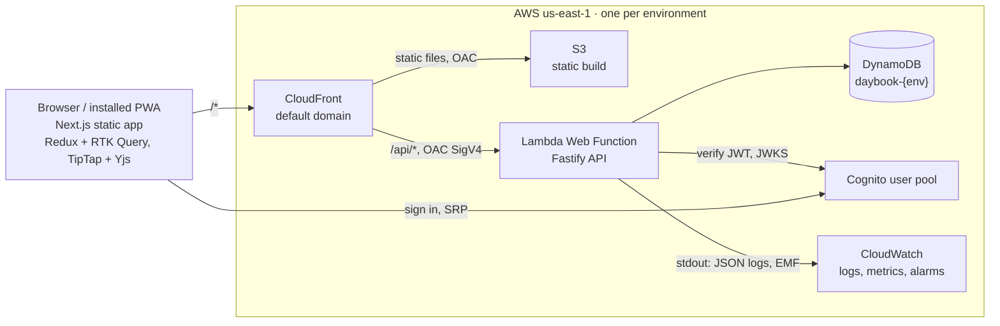
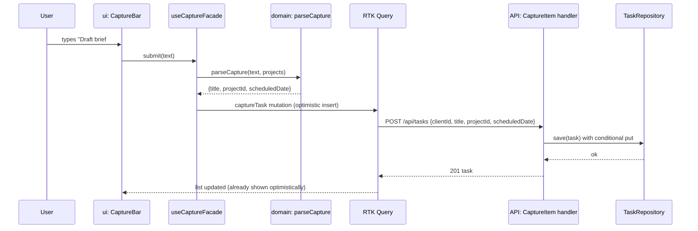

# Architecture overview

Daybook is a static Next.js web app and a Fastify API on AWS Lambda Web Functions, both behind one CloudFront distribution per environment, with DynamoDB for data and Cognito for sign-in. The MVP is online-first; offline mode arrives in v1.

Related: [data model](data-model.md) · [infrastructure and cost](infrastructure.md) · [observability](observability.md) · [decisions](../decisions/README.md)

## Stack at a glance

| Concern        | Choice                                                  | ADR                                                                                                                    |
| -------------- | ------------------------------------------------------- | ---------------------------------------------------------------------------------------------------------------------- |
| Repo           | Nx monorepo, strict TypeScript                          | [0001](../decisions/0001-nx-monorepo-strict-typescript.md)                                                             |
| Web            | Next.js static export, React, Redux Toolkit + RTK Query | [0002](../decisions/0002-nextjs-static-export.md), [0007](../decisions/0007-online-first-mvp-with-redux.md)            |
| API            | Fastify on Lambda Web Functions, zod contracts          | [0003](../decisions/0003-fastify-api-on-lambda-web-functions.md)                                                       |
| Data           | DynamoDB single table, on-demand                        | [0005](../decisions/0005-dynamodb-single-table.md)                                                                     |
| Notes          | TipTap editor, Yjs documents                            | [0006](../decisions/0006-notes-as-yjs-documents.md)                                                                    |
| Auth           | Cognito, email and password                             | [0008](../decisions/0008-cognito-email-auth.md)                                                                        |
| Infra          | AWS CDK, us-east-1, dev and prod                        | [0004](../decisions/0004-aws-cdk-for-infrastructure.md), [0012](../decisions/0012-environments-and-cost-guardrails.md) |
| Tests          | Vitest, Testing Library, Playwright, TDD                | [0009](../decisions/0009-tdd-with-vitest-and-playwright.md)                                                            |
| Observability  | CloudWatch logs, EMF metrics, alarms                    | [0010](../decisions/0010-observability-on-cloudwatch.md)                                                               |
| Code structure | Layers, ports and adapters                              | [0011](../decisions/0011-layered-architecture-ports-and-adapters.md)                                                   |

## System context

One origin serves both the app and `/api`, so there is no CORS and no cookie domain to manage.

## Module map

Nx projects and their tags. Arrows in the layer table of [0011](../decisions/0011-layered-architecture-ports-and-adapters.md) are enforced by lint.

| Project                     | Tags                                  | Contents                                                                                                                                                               |
| --------------------------- | ------------------------------------- | ---------------------------------------------------------------------------------------------------------------------------------------------------------------------- |
| `apps/web`                  | `scope:web`, `type:app`               | Next.js routes, layout shell, composition root (wires adapters into the store)                                                                                         |
| `apps/web-e2e`              | `scope:web`, `type:e2e`               | Playwright user journeys and axe checks                                                                                                                                |
| `apps/api`                  | `scope:api`, `type:app`               | `main.ts` (listens on `PORT`; runs in the Web Function and Docker), composition root, and `src/http/`: Fastify plugins and routes mapping HTTP to commands and queries |
| `apps/api-e2e`              | `scope:api`, `type:e2e`               | Contract tests against a running API                                                                                                                                   |
| `apps/infra`                | `scope:infra`, `type:app`             | CDK app and constructs                                                                                                                                                 |
| `libs/shared/domain`        | `scope:shared`, `type:domain`         | Entities, value objects, pure rules: Top 3 cap, day boundary, ISO week, tag parser, progress                                                                           |
| `libs/shared/contracts`     | `scope:shared`, `type:contracts`      | zod schemas for every request, response and analytics event                                                                                                            |
| `libs/shared/observability` | `scope:shared`, `type:infrastructure` | `Logger` and `Metrics` ports, pino and EMF adapters, request-id helpers                                                                                                |
| `libs/api/application`      | `scope:api`, `type:application`       | Command and query handlers, repository and service ports                                                                                                               |
| `libs/api/infrastructure`   | `scope:api`, `type:infrastructure`    | DynamoDB repositories and the table definition (shared with CDK, tests and the local seed), Yjs note store, Cognito and local token verifiers, clock, id generator     |
| `libs/web/data-access`      | `scope:web`, `type:data-access`       | Redux store, RTK Query API, HTTP client adapter, `AuthService` adapter, undo command bus                                                                               |
| `libs/web/feature-*`        | `scope:web`, `type:feature`           | One per area: `shell`, `auth`, `capture`, `today`, `week`, `projects`, `notes`, `search`. Facade hooks plus container components that pass view models to `ui`         |
| `libs/web/editor`           | `scope:web`, `type:feature`           | `NoteEditor` (TipTap + Yjs) and `NoteDocumentSync` adapter                                                                                                             |
| `libs/ui`                   | `scope:shared`, `type:ui`             | Presentational components matching `design/system/components`, CSS variables generated from `design/system/tokens.json`                                                |

Why `application` and `infrastructure` are libraries but routes are not: [ADR 0011](../decisions/0011-layered-architecture-ports-and-adapters.md#which-layers-are-libraries). The local Docker stack is described in [ADR 0015](../decisions/0015-local-stack-with-docker-compose.md).

Rules of thumb:

- `ui` components take props and emit callbacks; they never import Redux, the API or domain services.
- Feature containers call one facade hook and render `ui` components. Business rules live in `domain` or `application`, never in a component.
- Only `infrastructure` and `data-access` import SDKs (AWS, Amplify, Yjs providers).

## Key flows

### Capture a task (CAP-1 to CAP-4)

The client generates task ids (ULIDs), so the optimistic item and the stored item share an id and retries are idempotent.

### Edit a note

1. `NoteEditor` applies keystrokes to the local Yjs doc; TipTap renders immediately.
2. `NoteDocumentSync` buffers updates in IndexedDB and flushes them after 300 ms idle (at most every 1 s) to `POST /api/notes/{id}/updates`.
3. The handler loads the stored Yjs state, applies the updates, re-encodes, writes with a version condition and refreshes the note snapshot (title, plain text, block JSON, links).
4. Other open clients pick up the change through the poll below and fetch `GET /api/notes/{id}/doc?stateVector=…`.

### Cross-device freshness

While the app is visible, the client calls `GET /api/changes?since={cursor}` every 5 s. The response lists changed entity ids and types since the cursor (from the `GSI1` change feed, see [data model](data-model.md#change-feed)); the client invalidates the matching RTK Query tags. This meets the PRD's "changes reach other devices within 5 s" without WebSockets, which Web Functions do not support.

### Undo

Every user write in the web app is a command object with `execute` and `undo`. The undo bus keeps the last command for 6 seconds and shows the Undo toast; undo dispatches the inverse mutation. Only project deletion asks for confirmation (PRD UX principles).

## Cross-cutting rules

- **Dates and the day boundary.** Dates are stored as local calendar dates (`YYYY-MM-DD`) chosen on the client, using the person's time zone and the 04:00 day boundary from `domain`. The server never computes "today" from its own clock; queries pass the date.
- **Validation.** Every request and response is parsed by a `contracts` schema on both sides. Domain invariants (Top 3 cap, one daily note per date) are enforced again in the API with conditional writes.
- **Identity.** The API takes `userId` only from the verified token. Every DynamoDB key starts with `USER#{userId}`, so cross-user access needs a key the API never builds.
- **Errors.** API errors use RFC 9457 problem details with a stable `code`. The web app maps codes to the warm microcopy in `design/system/README.md`.
- **Security headers.** CloudFront response headers policy sets a strict CSP, HSTS, `X-Content-Type-Options` and `Referrer-Policy`. No third-party scripts.
- **Accessibility.** `ui` components carry the WCAG rules from the design system; e2e runs axe on every view.

## Moving to offline in v1

Planned path, not built in the MVP:

1. Persist the RTK Query cache and domain entities in IndexedDB.
2. Queue command objects in an outbox while offline and replay them in order on reconnect.
3. Server applies commands idempotently (client ids already make them safe) and returns the change cursor.
4. Notes already work offline once Yjs updates are queued; no format change needed.
