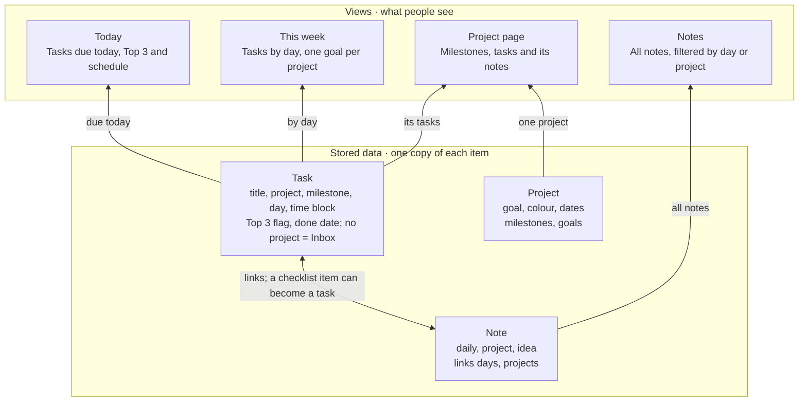
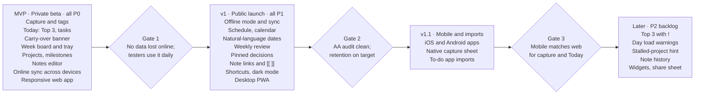

# Daybook — Product Requirements

Oct 20, 2026 · Nuwan K · Status: Draft

Revised Oct 20, 2026: the MVP is online-first and full offline operation moves to v1 ([ADR 0007](../decisions/0007-online-first-mvp-with-redux.md)); note bodies are Yjs documents ([ADR 0006](../decisions/0006-notes-as-yjs-documents.md)).

Live version: [Daybook — Product Requirements](https://claude.ai/code/artifact/aa5abdb6-2db2-4e63-997e-958275ed5661) · Design: [Daybook design canvas](https://claude.ai/artifact/VHiRsqmVbKtnzEJyDhr9SE)

## Summary

Daybook is a minimal note-taking app that puts notes, daily plans, weekly plans and long-running projects in one place, so people stop juggling a notes app, a to-do list and a project tool. Its promise: capture anything in two seconds, know what matters today in one glance, and see how today's work moves a bigger project forward.

**Problem.** People who mix daily work with longer projects scatter their thinking across tools. Notes lose their link to the tasks they spawn, daily lists ignore project milestones, and weekly planning happens in someone's head. The result is unfinished work that silently disappears and projects that drift.

**Approach.** One capture bar, three time horizons (today, this week, the project) and notes that link to all three. A calm pastel interface with one colour per project makes the connections visible without extra chrome.

**Design reference.** The interactive design canvas holds five screens: Today, This week, Project, Notes and Mobile capture — [Daybook design canvas](https://claude.ai/artifact/VHiRsqmVbKtnzEJyDhr9SE). Where this PRD and the canvas disagree, this PRD wins and the canvas is updated.

## Goals and non-goals

v1 succeeds if a person can run their whole day and week from Daybook without a second tool for notes or tasks.

**Goals**

1. **Two-second capture.** Any task or thought can be captured from anywhere in the app (and from the phone) in one action, without choosing a location first.
2. **A focused day.** Today shows the Top 3, the rest of the day's tasks, the schedule and a daily note on one screen, with no scrolling on a 1440 × 900 laptop display.
3. **A real weekly plan.** One goal per project per week, a seven-day board and a tray for unscheduled work, so weekly planning takes under 10 minutes.
4. **Projects for longer work.** Milestones, tasks and notes for work that spans weeks, with today's tasks visibly tied to the project they move.
5. **Nothing silently lost.** Unfinished tasks are offered back the next day; nothing rolls over without the person deciding.
6. **Calm by default.** A minimal pastel interface that passes WCAG 2.1 AA.

**Non-goals for v1**

- Team collaboration, shared projects, assignees or comments.
- Gantt charts, dependencies between tasks, time tracking or resource planning.
- A full calendar client; v1 reads calendar events but does not create or edit them.
- Rich documents (embedded databases, whiteboards, page templates marketplace).
- AI features in v1; AI agents start in v1.1, as set out in the AI agents section.
- Web clipper, email-to-inbox and third-party integrations beyond calendar read.

## Target users

The primary user is an individual knowledge worker who runs two to five projects at once alongside daily admin. Daybook v1 is single-player; teams are out of scope.

| Persona | Context | What they need most | Where they use it |
| --- | --- | --- | --- |
| Independent professional (designer, consultant, freelancer) | Several client projects plus their own admin | See every project's next step without opening each one | Laptop all day, phone for capture |
| Graduate student or researcher | One long project (thesis) plus teaching and reading | Break a months-long project into weekly goals and daily blocks | Laptop for writing, phone for ideas |
| Busy individual contributor | Day job tasks plus a side project or personal goals | A daily Top 3 and a calm place to think | Laptop at work, phone in the evening |

**Jobs to be done**

- When a thought or task comes up mid-flow, I want to dump it somewhere safe in seconds, so I can get back to what I was doing.
- When I start my day, I want to see the three things that matter and when I have time to do them, so I don't waste the morning deciding.
- When I plan my week, I want to set one goal per project and spread the work across the days, so the week has a shape before it starts.
- When I work on a long project, I want its milestones, tasks and notes together, so I can pick it up again after days away.
- When I write a note, I want it tied to the day and project it belongs to, so I can find it from either side later.
- When I didn't finish something, I want to decide consciously whether to carry it forward, so my list stays honest.

## Information architecture

Daybook stores three kinds of item — tasks, projects and notes — and shows them through four views; days and weeks are never stored, only queried.

Today, This week and the project page are filters over the same task records, so ticking a task in one view updates the others at once.

**Core concepts**

- **Inbox**: tasks captured without a project. Shown with a grey chip until filed.
- **Top 3**: up to three tasks per day marked as the day's focus.
- **Milestone**: a dated stage inside a project that groups its tasks (Discovery, Wireframes, Launch).
- **Weekly goal**: one sentence per project per week; progress comes from the tasks linked to it.
- **Daily note**: one free-form note per day, created when you first type in it.
- **Carry-over**: the next-day decision to bring unfinished tasks forward or let them go.

## Functional requirements

Requirements are numbered by area and prioritised P0 (MVP must-have), P1 (v1 launch) and P2 (after launch).

### 1. Capture

Capture is the front door: one input, available everywhere, that never asks where something goes before saving it.

| ID | Requirement | Priority |
| --- | --- | --- |
| CAP-1 | A capture bar sits at the top of Today and opens from anywhere with ⌘K / Ctrl+K then typing. | P0 |
| CAP-2 | Enter saves the text as a task on today's list; the field clears and keeps focus for the next item. | P0 |
| CAP-3 | An inline tag (`#website`, `#thesis`) files the item under the matching project and is stripped from the title. | P0 |
| CAP-4 | Items with no tag land in Inbox, shown with a neutral grey chip. | P0 |
| CAP-5 | Shift+Enter (desktop) or the Task / Note toggle (mobile) saves the text as a note instead of a task. | P1 |
| CAP-6 | Natural-language dates (`tomorrow`, `fri`, `oct 30`) schedule the task on that day. | P1 |
| CAP-7 | Unknown tags offer “Create project #name” inline rather than failing silently. | P1 |
| CAP-8 | `!` marks an item as a Top 3 candidate. | P2 |

Acceptance: from a cold app, a task is saved in ≤ 2 seconds and ≤ 1 keystroke beyond the text; the saved item appears in the list within 100 ms; a project tag always matches case-insensitively.

### 2. Today (daily plan)

Today answers “what matters now, and when will I do it?” on a single screen.

| ID | Requirement | Priority |
| --- | --- | --- |
| TOD-1 | Header shows weekday, date and ISO week number, with previous / next day and a Today button. | P0 |
| TOD-2 | **Top 3**: up to three tasks pinned as the day's focus, numbered and coloured by project. A fourth pin asks which one to swap out. | P0 |
| TOD-3 | **Also today**: every other task scheduled today, with a done count and a progress bar (done ÷ total). | P0 |
| TOD-4 | Ticking a task strikes it through in place; it is not removed until the next day, so progress stays visible. | P0 |
| TOD-5 | **Carry-over banner**: unfinished tasks from the previous working day appear in a dismissible banner with “Bring to today” and “Dismiss”. Dismissed tasks go back to the project or Inbox unscheduled. | P0 |
| TOD-6 | **Schedule**: calendar events and time-blocked tasks in time order, with a “now” line and visible free gaps. | P1 |
| TOD-7 | Dragging a task into a free gap creates a time block of the task's estimate (default 30 min). | P1 |
| TOD-8 | **Daily note**: one note per day, created on first keystroke, with an Open link to the full editor. | P0 |
| TOD-9 | Tasks reorder by drag and by Alt+↑ / Alt+↓. | P1 |

Acceptance: at 1440 × 900 the Top 3, at least five other tasks, the schedule until 18:00 and the daily note preview are visible without scrolling; the carry-over banner never appears twice for the same day.

### 3. This week (weekly plan)

This week turns project goals into a seven-day plan.

| ID | Requirement | Priority |
| --- | --- | --- |
| WK-1 | Header shows week number and date range, with previous / next week. Weeks start Monday by default; Sunday is a setting. | P0 |
| WK-2 | **Goals this week**: at most one goal per active project, each showing progress as linked tasks done of total. | P0 |
| WK-3 | **Plan board**: seven day columns with that day's tasks as project-coloured cards; today's column is highlighted; past days show done tasks struck through. | P0 |
| WK-4 | Tasks drag between days; on mobile, a long-press opens a “Move to” day picker. | P0 |
| WK-5 | **Not scheduled yet** tray lists project tasks with no day, each with a “Do today” action. An empty tray shows “Everything has a day.” | P0 |
| WK-6 | **Weekly review** card with three fixed prompts that opens a pre-filled review note. | P1 |
| WK-7 | A soft load indicator per day warns when scheduled estimates exceed the person's working hours. | P2 |

Acceptance: a person can schedule five tray items across the week in under 30 seconds with drag only; the board scrolls horizontally inside its box below 1000 px wide rather than squashing columns.

### 4. Projects (longer work)

A project holds work that spans weeks: a goal, milestones, tasks and notes.

| ID | Requirement | Priority |
| --- | --- | --- |
| PRJ-1 | Creating a project needs only a name; the app assigns the next free pastel colour, editable later. | P0 |
| PRJ-2 | Project header shows name, one-line goal, target date, current phase and progress (tasks done of total). | P0 |
| PRJ-3 | **Milestones**: an ordered list, each with dates, status (Done, In progress, Up next) and its tasks; the active milestone is expanded by default. | P0 |
| PRJ-4 | Overview / Plan / Notes tabs; Overview shows milestones and notes side by side. | P0 |
| PRJ-5 | **Pinned decision**: any project note can be pinned to the top as the current key decision. | P1 |
| PRJ-6 | **On your plan**: chips linking to the days this week where the project's tasks are scheduled. | P1 |
| PRJ-7 | Projects can be archived; archived projects leave the sidebar but stay searchable. | P0 |
| PRJ-8 | A project with no task done in 14 days shows a gentle “stalled” hint in the sidebar. | P2 |

Acceptance: a new project with three milestones and ten tasks can be set up in under three minutes using the keyboard only; progress numbers on the project page and the weekly goal card always agree.

### 5. Notes

Notes are plain, fast documents that always know which day and project they belong to.

| ID | Requirement | Priority |
| --- | --- | --- |
| NOT-1 | Two-pane layout: a filterable note list and the editor. Filters: All, Daily, each project, Ideas. | P0 |
| NOT-2 | Editor supports headings, paragraphs, bullet lists, checklists, bold, italic and links. Markdown shortcuts (`#`, `-`, `[]`) work as you type. | P0 |
| NOT-3 | A checklist item can be promoted to a task with one action, keeping a link back to the note. | P1 |
| NOT-4 | Each note has a group chip (Daily, project or Ideas) and a “Linked” footer listing the days and projects it is tied to. | P0 |
| NOT-5 | Notes save automatically on every change; no Save button exists. | P0 |
| NOT-6 | `[[` opens a picker to link another note, day or project. | P1 |
| NOT-7 | Note history: the last 30 days of versions can be viewed and restored. | P2 |

Acceptance: typing latency stays under 16 ms per keystroke in a 5,000-word note; a closed and reopened app never loses more than the last 1 second of typing.

### 6. Search and navigation

| ID | Requirement | Priority |
| --- | --- | --- |
| NAV-1 | Persistent sidebar: Today, This week, Notes, then the project list with colour dots and New project. | P0 |
| NAV-2 | ⌘K opens a command bar that searches tasks, notes and projects and also runs commands (new note, go to week). | P0 |
| NAV-3 | Keyboard shortcuts: G then T / W / N jumps to Today, Week, Notes; ? lists all shortcuts. | P1 |
| NAV-4 | Below 820 px the sidebar collapses into a top menu; content never scrolls sideways except the week board. | P0 |

### 7. Mobile

Mobile is for capture and checking today, not for heavy planning. P0 items ship first in the responsive web app; native iOS and Android apps follow in v1.1.

| ID | Requirement | Priority |
| --- | --- | --- |
| MOB-1 | Today view: “Now” card for the current time block, Top 3 and Also today with checkboxes. | P0 |
| MOB-2 | A floating capture button opens a bottom sheet with a Task / Note toggle, text field and project chips. | P0 |
| MOB-3 | Bottom tab bar: Today, Week, Notes, Projects. | P0 |
| MOB-4 | Home-screen widget and share-sheet extension for capture. | P2 |

Acceptance: from unlocking the phone, a task is captured in under 5 seconds with the app already installed.

## UX principles

Every screen should feel quiet until the person acts; structure comes from layout and colour, not from chrome.

1. **Capture first, organise later.** Saving never requires a decision. Filing, scheduling and prioritising are optional and can happen later.
2. **Three horizons, one model.** Today, This week and Project are three views of the same tasks; a change in one shows in the others immediately.
3. **Colour means project.** Each project owns one pastel used for its dot, chips, cards and time blocks. Colour is never decorative, and never the only cue: chips also carry the project name.
4. **Decide, don't drift.** Unfinished work is offered back, never auto-rolled. The carry-over banner and the unscheduled tray make leftovers a conscious choice.
5. **Done stays visible.** Completed tasks strike through in place for the rest of the day so progress is felt.
6. **Keyboard and touch are equals.** Every action has a keyboard path on desktop and a 44 × 44 px target on touch.
7. **No modal dead ends.** Panels and sheets close with Esc or a tap outside; nothing blocks the main view except destructive confirmations.

**Key interaction details**

- **Tag syntax.** `#project` files, `!` marks Top 3 (P2), a date word schedules. Parsed tokens show as chips in the field before saving so people see what will happen.
- **Empty states.** Each view says what goes there and offers the one action that fills it, for example Today with no tasks: “What are the three things that would make today good?” with the capture bar focused.
- **Undo over confirm.** Completing, moving, deleting and dismissing show a 6-second Undo toast instead of a confirmation dialog. Only deleting a project asks for confirmation.
- **Motion.** Transitions are 150–200 ms ease-out, limited to opacity and position; all motion is disabled when the OS requests reduced motion.
- **Day boundary.** The new day starts at 04:00 local time so late-night work still counts as “today” (setting).
- **Microcopy.** Short, warm and specific: “Bring to today”, not “Migrate tasks”; “Everything has a day. Nice.”, not “No items”.

## Visual design system

The look is a near-white ground, one sans-serif typeface, dark ink actions and six pastel project colours; each pastel ships as a trio so text on it always passes 4.5:1.

**Neutrals**

| Token | Hex | Use |
| --- | --- | --- |
| `bg` | #FCFCFD | Page background |
| `surface` | #FFFFFF | Cards, editor, inputs |
| `sidebar` | #F4F3F8 | Sidebar, segmented controls, quiet chips |
| `border` | #E8E6EF | Card and input borders |
| `ink` | #1F1D2B | Body text, primary buttons |
| `ink-muted` | #625F72 | Labels, meta text (5.6:1 on sidebar) |
| `ink-done` | #6F6C7E | Struck-through completed tasks |

**Project pastels** (assigned in this order to new projects)

| Name | Background | Text on background | Dot / bar | Contrast (text on bg) |
| --- | --- | --- | --- | --- |
| Lavender | #ECE7FD | #4B3A9E | #B7A6F5 | about 7.3:1 |
| Mint | #DFF3E8 | #24684A | #8FD4AE | about 5.8:1 |
| Peach | #FDE6D9 | #94431C | #F5B08C | about 5.7:1 |
| Rose | #FBE1EA | #8E2F52 | #F0A3BE | about 6.5:1 |
| Sky | #DDEBFB | #275A8E | #93BDEE | about 5.9:1 |
| Butter | #FBF0C4 | #6E5400 | #EBCB5C | about 5.9:1 |

Butter is reserved for system notices (carry-over banner, pinned decisions) and Daily notes; Sky is used for calendar events. Projects beyond six reuse the list with a second dot shape.

**Type.** Plus Jakarta Sans, weights 400 / 500 / 600 / 700. Scale: page title 34 / 700, section heading 17 / 700, task 15 / 500, body 14–16, meta 12–13 / 600. Uppercase labels use 0.05em tracking.

**Shape and spacing.** 8 px spacing grid; radii 10 (chips, small cards), 12 (buttons, inputs), 16–18 (cards), 22 (project header), 99 (pills). Borders are 1 px; shadows are limited to 0 1px 2px for raised nav items and the capture bar.

**Core components.** Capture bar, task row (checkbox, title, project chip), Top 3 card, schedule block, day column, goal card, milestone accordion, note card, segmented tabs, filter chips, carry-over banner, bottom sheet, undo toast.

**Dark mode** (P1) keeps the same hues: pastel backgrounds become 18% tints on #17161F and the text colours lighten to keep 4.5:1.

## Data model

Six entities cover v1; Task is the hub, and Day and Week are derived views rather than stored containers.

| Entity | Key fields | Relationships |
| --- | --- | --- |
| Project | id, name, goal, colour, targetDate, status (active, archived), createdAt | Has many Milestones, Tasks, Notes; has one WeeklyGoal per week |
| Milestone | id, projectId, title, startDate, endDate, order, status (done, active, next) | Belongs to Project; has many Tasks |
| Task | id, title, projectId?, milestoneId?, scheduledDate?, timeBlock {start, end}?, estimateMin, isTop3, order, doneAt?, sourceNoteId?, createdAt | Belongs to Project (or Inbox when null), optionally a Milestone and a source Note |
| Note | id, title, body (Yjs document with a block JSON snapshot), kind (daily, project, idea), projectId?, date?, pinned, updatedAt | Belongs to a Project or a Day; links to other Notes, Days, Projects |
| WeeklyGoal | id, projectId, isoWeek, title | Belongs to Project; progress = linked Tasks done ÷ total |
| CarryOverDecision | id, date, taskIds, action (brought, dismissed) | Records each day's carry-over choice so the banner shows once |

**Rules**

- A task is “today” when `scheduledDate` equals the current day (after the 04:00 boundary).
- Top 3 is a per-day flag; at most three tasks per day may have `isTop3 = true`.
- A daily note is unique per date; it is created lazily on first edit.
- Links between notes, days and projects are stored as a separate `Link` table (fromId, toId, type) so backlinks are a single query.
- Calendar events are read-only, cached for 14 days around today and never stored as Tasks.

## Non-functional requirements

Daybook must feel instant, and from v1 work offline; speed is part of the minimal feel, not a separate feature.

| Area | Requirement |
| --- | --- |
| Performance | Cold start to interactive Today ≤ 1.5 s on a mid-range laptop and ≤ 2 s on a mid-range phone. Any view switch ≤ 100 ms. Typing latency < 16 ms. |
| Offline | MVP: online-first with optimistic updates; while offline, writes pause behind a quiet banner and note typing is buffered locally. v1 (P1): all features work offline against a local store, and changes sync when the connection returns. |
| Sync | Changes reach other signed-in devices within 5 s when online. Tasks merge per field (last writer wins); notes merge as CRDT documents, so concurrent edits are kept rather than overwritten. |
| Durability | No more than 1 s of typing lost on crash; unsent note edits are buffered on the device until the server confirms; account export to Markdown + JSON at any time. |
| Accessibility | WCAG 2.1 AA: 4.5:1 text contrast, 44 × 44 px touch targets, full keyboard operation, visible focus rings, screen-reader labels on all icon buttons, reduced-motion support. |
| Privacy and security | Data encrypted in transit (TLS 1.2+) and at rest. No third-party ad or tracking SDKs. Analytics events carry no note or task content. Calendar access is read-only and revocable. |
| Platforms | Web app (latest two versions of Chrome, Safari, Firefox, Edge) and installable desktop PWA at launch; iOS and Android apps in v1.1. |
| Responsiveness | Layouts work from 360 px to 2560 px wide; below 820 px the sidebar collapses and two-column views stack. |
| Localisation | All copy externalised; dates, week start and 12 / 24 h time follow the device locale. English only at launch. |

## Success metrics

The north-star metric is **weekly planned days**: the number of days per week on which a person sets a Top 3 and completes at least one of them. Targets below are proposed starting points to confirm after the beta baseline.

| Metric | Definition | Proposed target (90 days after launch) |
| --- | --- | --- |
| Weekly planned days | Days per active user per week with a Top 3 set and ≥ 1 Top 3 task done | 3.5 |
| Capture speed | Median time from opening capture to saved item | ≤ 2 s |
| Week-4 retention | Share of new users active in their fourth week | 35% |
| Weekly plan adoption | Share of weekly active users who set at least one weekly goal | 40% |
| Projects in use | Share of weekly active users with ≥ 1 project that had a task done that week | 50% |
| Carry-over honesty | Share of carry-over banners acted on (brought or dismissed) rather than ignored | 70% |
| Accessibility defects | Open WCAG 2.1 AA issues at launch | 0 |

**Analytics events** (no content, only ids and counts): `capture_opened`, `item_captured` (type, has_tag, has_date, ms_to_save), `task_completed` (is_top3, view), `top3_set`, `carryover_shown`, `carryover_action` (brought / dismissed / ignored), `week_viewed`, `weekly_goal_set`, `task_moved` (from_day, to_day, method), `project_created`, `milestone_completed`, `note_created` (kind), `search_used` (result_type).

## Release plan

Ship an online-first private-beta MVP with every P0 requirement, launch publicly once offline sync and accessibility are proven, then add native mobile apps and imports.

Phase dates are not set yet; each gate is a go / no-go review against its criteria, and nothing moves to the next phase on schedule alone.

## AI agents

AI agents arrive after the v1 launch, starting with capture tidying and notes Q&A in v1.1. Every agent suggests and the person approves, so “decide, don't drift” still holds.

**Guardrails for every agent**

1. **Suggest, never silently change.** Proposals appear as pastel “Suggested” chips with Accept and Dismiss; accepted changes go through the normal Undo toast.
2. **Capture speed is untouchable.** Raw text saves instantly; tidying runs in the background and updates the item afterwards, so CAP acceptance criteria still hold.
3. **Opt-in per feature.** AI is off until the person turns each agent on. Settings state what content is sent to the model and that it is not used for training.
4. **Show the source.** Answers and suggestions link to the notes, tasks or milestones they came from.
5. **No content in analytics.** AI events log only ids, counts and accept / dismiss outcomes.

**Integration points**

| ID | Agent | Where | What it does | Phase |
| --- | --- | --- | --- | --- |
| AI-1 | Capture tidier | Capture, Inbox | Splits a brain dump into separate items, picks the project, reads dates and estimates time | v1.1 |
| AI-2 | Notes Q&A | ⌘K command bar, Notes | Answers questions from the person's notes, daily notes and project notes, citing each source | v1.1 |
| AI-3 | Action-item finder | Notes | Spots action items in a note and offers to turn them into linked tasks (automated NOT-3) | v1.1 |
| AI-4 | Morning planner | Today | Suggests a Top 3 from deadlines, active milestones and weekly goals, and fits tasks into free calendar gaps | v1.2 |
| AI-5 | Carry-over coach | Today banner | Suggests reschedule, split, return to project or drop for each leftover; flags tasks that slipped three or more times | v1.2 |
| AI-6 | Weekly planner | This week | Drafts one goal per project from its milestones and spreads tray tasks across days within working hours | v1.2 |
| AI-7 | Review drafter | Weekly review | Pre-fills the Sunday review from done tasks, slipped tasks and daily notes | v1.2 |
| AI-8 | Project breakdown | Projects | Drafts milestones and starter tasks from a project name and one-line goal | Later |
| AI-9 | Catch me up | Project page | Summarises where the person left off, key decisions and the next step after days away | Later |
| AI-10 | Stalled-project nudge | Sidebar | Suggests one small next step for a project with no task done in 14 days (builds on PRJ-8) | Later |
| AI-11 | Plain-language commands | ⌘K command bar | Runs edits such as “move all thesis tasks from Friday to Monday” after showing a preview | Later |
| AI-12 | Voice capture | Mobile | Sends dictated brain dumps through the capture tidier | Later |
| AI-13 | Daybook MCP server | Outside assistants | Lets assistants such as Claude read the plan and add tasks; opens the way to email and Slack capture | Later |

**Data model additions**

- New `Suggestion` entity: id, agent, targetType, targetId?, proposedChange (JSON), reason, sources, status (pending, accepted, dismissed), createdAt.
- `Task` and `Note` gain `createdBy` (person or agent id) so agent-made items can be filtered and audited.

**Measuring agents**

- Acceptance rate per agent (accepted ÷ shown); an agent that stays low after two iterations is reworked or removed.
- Weekly planning time with and without AI-6, against the 10-minute goal.
- Share of Notes Q&A answers where the person opens a cited source.

**Agent-specific risks**

- Wrong suggestions erode trust: start with low-stakes agents (AI-1 to AI-3) and keep every change undoable.
- Sending note content to a model is a privacy change from v1: opt-in, clear disclosure and a per-agent off switch.
- Model cost per active user: use small models for parsing (AI-1) and keep larger models for Q&A and planning.

## Risks, dependencies and open questions

The biggest risk is that Daybook becomes one more place to check; every mitigation below aims at making it the only place.

| Risk | Impact | Mitigation |
| --- | --- | --- |
| Users keep their old to-do app and Daybook becomes a second inbox | Low retention | Import from Todoist, Things and Apple Reminders in v1.1; fast capture on every surface |
| Planning feels like homework | Weekly plan adoption stays low | Weekly plan is optional; goals take one line; the review is three prompts, not a form |
| Too few project colours for heavy users | Colour stops meaning project | Six pastels plus dot shapes; archive prompt for stalled projects |
| Offline sync conflicts corrupt notes | Lost trust | CRDT notes (Yjs) from the MVP, note history, offline sync built and tested before any other P1 work |
| Pastel palette fails contrast in dark mode | Accessibility regression | Separate dark tokens, automated contrast checks in CI |

**Dependencies**

- Google and Microsoft calendar APIs for read-only events (TOD-6).
- Offline local storage and a command outbox for v1, built in-house on the MVP's command objects ([ADR 0007](../decisions/0007-online-first-mvp-with-redux.md)).
- Plus Jakarta Sans licence (SIL Open Font License) and self-hosting.

**Open questions**

- [ ] Should Top 3 be capped at three, or allow a user setting of one to five?
- [ ] Do dismissed carry-over tasks return to the unscheduled tray or to Inbox?
- [ ] Is the week board's default start Monday everywhere, or locale-based?
- [ ] Should notes support images and file attachments in v1, or wait for v1.1?
- [ ] Pricing: free with limits, or a paid plan from day one?
- [ ] Do we name the product Daybook, pending a trademark check?
